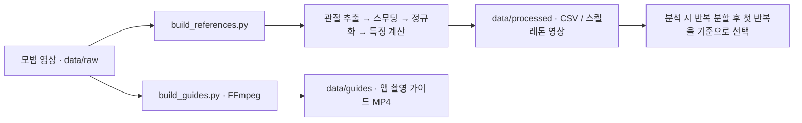
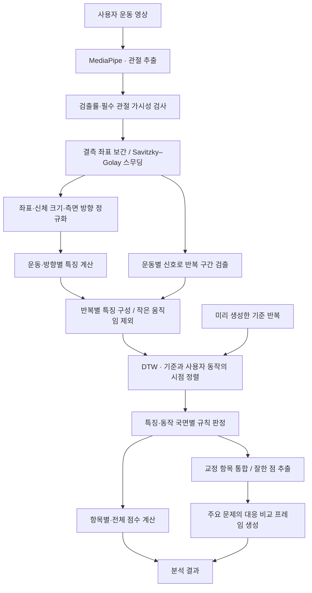

# PoseFeedback · 운동 자세 피드백

**운동 영상을 모범 동작과 비교하고, 교정이 필요한 순간을 시각적으로 보여주는 운동 자세 분석 프로젝트입니다.**

사용자가 iPhone으로 운동을 촬영하거나 앨범 영상을 선택하면, 서버가 관절 움직임을 분석해 자세 점수와 반복별 피드백을 제공합니다. 결과에서는 모범 자세와 사용자 자세를 나란히 비교하고, 기록 화면에서는 날짜별 운동 결과와 항목별 변화를 확인할 수 있습니다.

MediaPipe의 사전 학습된 포즈 추정 모델로 관절을 추출하고, **좌표 정규화 → 반복 분할 → DTW 동작 정렬 → 운동별 규칙 판정**으로 분석합니다. 피드백과 점수는 관절 각도·비율·비대칭 지표를 바탕으로 계산합니다.

## 주요 기능

- **촬영 안내**: 운동별 촬영 방향·구도 안내와 기준 영상 재생.
- **영상 분석**: 직접 촬영·앨범 선택, 업로드 진행률과 분석 대기 상태 표시.
- **결과 요약**: 자세 점수, 방향별 반복 횟수, 우선 교정 항목과 잘한 점 제공.
- **자세 비교**: 주요 문제 구간의 모범·사용자 프레임 비교, 구간 이동과 0.5배속 재생.
- **기록 관리**: 로그인한 사용자의 분석 결과 저장, 운동 캘린더와 점수·항목별 추이 확인.

| 운동 | API 식별자 | 지원 촬영 방향 |
|---|---|---|
| 스쿼트 | `squat` | 측면 또는 정면, 두 방향 함께 제출 가능 |
| 런지 | `lunge` | 측면 또는 정면, 두 방향 함께 제출 가능 |
| 사이드 레터럴 레이즈 | `lateral_raise` | 정면 |

## 전체 시스템 아키텍처

클라이언트부터 HTTPS 진입점, 서버 내부 분석, 영구 저장소, 기준 데이터 준비까지의 전체 구성입니다. 배포 영역은 저장소의 **Lightsail + Docker Compose + Caddy** 설정을 기준으로 표시했습니다.

```mermaid
flowchart TB
    subgraph CLIENT["클라이언트 · iPhone / iOS 17 이상"]
        direction LR
        INPUT["카메라 / 사진 보관함<br/>촬영·영상 선택"]
        IOS["SwiftUI 앱<br/>540p 압축·업로드 / 결과·비교 / 기록·추이"]
        TOKEN["Keychain<br/>로그인 토큰 보관"]
        INPUT --> IOS
        IOS <--> TOKEN
    end

    DNS["DuckDNS<br/>도메인 → 서버 IP"]

    subgraph SERVER["배포 서버 · AWS Lightsail / Docker Compose"]
        CADDY["caddy 컨테이너 · Caddy<br/>HTTPS 종료 / 인증서 발급·갱신 / 리버스 프록시"]
        GUIDES["촬영 가이드 MP4<br/>호스트 data/guides → /srv/guides 읽기 전용 마운트"]

        subgraph API_CONTAINER["api 컨테이너 · Uvicorn / FastAPI · 8080"]
            direction TB
            API["API 라우터<br/>회원가입·로그인 / 영상 분석 / 기록·추이"]
            AUTH["auth.py<br/>bcrypt 비밀번호 검증 / JWT 인증"]
            ENGINE["분석 엔진 · analyze.py<br/>MediaPipe → 전처리 → 특징·반복 추출<br/>DTW 정렬 → 규칙 판정 → 점수·비교 프레임"]
            HISTORY["history.py / media.py<br/>사용자별 기록 접근 / 결과·이미지 저장 및 조회"]
            REF["이미지에 포함된 기준 데이터<br/>data/processed · 관절·특징 CSV / 스켈레톤"]
            TEMP["요청별 임시 작업 폴더<br/>업로드 원본·중간 파일 / 요청 종료 시 삭제"]
        end

        subgraph STORAGE["영구 저장"]
            direction LR
            DB[("db 컨테이너 · PostgreSQL 16<br/>사용자·분석 결과 / pgdata 볼륨")]
            MEDIA[("비교 JPEG<br/>media 볼륨 / API의 /app/media")]
            CERT[("HTTPS 인증서<br/>caddy_data 볼륨")]
        end
    end

    subgraph PREP["기준 데이터 준비"]
        direction LR
        RAW["모범 영상<br/>data/raw"]
        BUILD["Docker 이미지 빌드<br/>build_references.py"]
        GUIDE_BUILD["배포 전 가이드 생성<br/>build_guides.py / FFmpeg"]
        RAW --> BUILD
        RAW --> GUIDE_BUILD
    end

    subgraph DEV["개발·검증 환경 · 별도 실행"]
        direction LR
        GRADIO["Gradio 웹 UI<br/>app.py"]
        LOCAL["로컬 Python 분석 모듈<br/>동일한 분석 코드·기준 데이터 사용"]
        GRADIO -->|함수 직접 호출| LOCAL
    end

    IOS -.->|도메인 조회| DNS
    IOS <-->|HTTPS 443 · API 요청·응답 / 가이드 재생| CADDY
    CADDY -->|API 요청 · api:8080| API
    CADDY -->|/guides/ 정적 파일 제공| GUIDES
    CADDY --> CERT
    API --> AUTH
    AUTH -->|SQLAlchemy · 계정 조회·저장| DB
    API -->|프로세스 내부 스레드풀에서 분석| ENGINE
    ENGINE <--> TEMP
    REF --> ENGINE
    API --> HISTORY
    HISTORY <-->|SQLAlchemy · 기록 읽기·쓰기| DB
    HISTORY <--> MEDIA
    BUILD -.->|생성 후 이미지에 포함| REF
    GUIDE_BUILD -.->|생성 후 호스트 경로에 배치| GUIDES

    classDef client fill:#eff6ff,stroke:#2563eb,color:#172554
    classDef service fill:#f0fdf4,stroke:#16a34a,color:#14532d
    classDef storage fill:#fff7ed,stroke:#ea580c,color:#7c2d12
    classDef preparation fill:#faf5ff,stroke:#9333ea,color:#581c87
    class INPUT,IOS,TOKEN client
    class CADDY,API,AUTH,ENGINE,HISTORY service
    class DB,MEDIA,CERT,REF,GUIDES,TEMP storage
    class RAW,BUILD,GUIDE_BUILD,GRADIO,LOCAL preparation
```



실선은 실행 중의 호출·데이터 접근, 점선은 도메인 조회와 사전 생성 데이터의 배치 관계입니다. DNS는 서버 주소를 찾는 데 사용하며, 영상과 분석 결과는 앱과 Caddy 사이의 HTTPS 연결로 전달됩니다.

- **실행 경계**: Caddy, FastAPI, PostgreSQL은 별도 컨테이너입니다. 분석 엔진은 API 컨테이너 안의 Python 모듈이며, API 응답은 분석이 완료된 뒤 반환합니다.
- **저장 경계**: 계정·분석 결과와 비교 이미지는 볼륨에 유지합니다. 업로드 원본과 중간 분석 파일은 요청별 임시 폴더에서 처리한 뒤 삭제합니다.
- **접근 경로**: Caddy는 API 요청을 `api:8080`으로 전달하고 가이드 영상은 직접 제공합니다. HTTPS 배포 설정에서 API의 호스트 포트는 `127.0.0.1:8000`에 바인딩됩니다.
- **개발 환경**: Gradio는 별도로 실행해 로컬 분석 함수를 호출합니다. Python으로 API를 직접 실행할 때의 기본 DB는 SQLite입니다.

| 구성 요소 | 역할 |
|---|---|
| iOS 앱 | 영상 촬영·압축·업로드, 인증, 분석 결과·비교 화면·기록 표시 |
| FastAPI | 요청 검증, 영상 분석 호출, 응답 구성, 사용자별 기록 접근 제어 |
| 분석 모듈 | 관절 추출부터 점수·피드백·비교 프레임 선정까지 처리 |
| PostgreSQL | 사용자 계정, 분석 요약, 점수, 측정값, 피드백·이미지 참조 저장 |
| 이미지 저장소 | 기록에 필요한 JPEG 파일 저장. Docker의 `media` 볼륨 사용 |
| Caddy | HTTPS 인증서 발급·갱신, API 프록시, 촬영 가이드 정적 파일 제공 |
| Gradio | 분석 모듈을 직접 호출하는 개발·검증용 웹 인터페이스 |

분석은 HTTP 요청 안에서 완료되며, 연산은 FastAPI 프로세스의 스레드풀에서 실행됩니다. 기준 데이터는 서버 파일에서 읽고, Gradio도 동일한 분석 코드를 사용합니다. Docker Compose는 PostgreSQL을 사용하며, Python으로 직접 실행할 때는 기본적으로 SQLite를 사용합니다.

### 요청과 데이터 저장 흐름

1. 앱이 영상을 540p로 압축하고 운동 종류·촬영 방향과 함께 `/analyze`로 전송합니다.
2. API가 파일 크기와 입력을 확인하고 요청별 임시 작업 폴더에 영상을 저장합니다.
3. 분석 모듈이 기준 동작과 비교해 점수·피드백·비교 이미지를 생성합니다.
4. 인증된 사용자이고 인식된 반복이 있으면 DB에 분석 결과를, 이미지 저장소에 비교 JPEG를 저장합니다.
5. API가 결과와 비교 이미지의 data URI, 저장된 경우 `session_id`를 반환합니다. 요청 처리가 끝나면 업로드 원본과 임시 분석 파일을 삭제합니다.
6. 앱은 기록 API로 이전 결과를 다시 불러옵니다. 서버는 사용자 소유 기록만 제공하며 저장된 이미지로 응답을 구성합니다.

## 분석 파이프라인

### 1. 기준 데이터 준비

운동·촬영 방향별 모범 영상으로 분석 기준을 미리 생성합니다. `build_references.py`는 모델을 학습하는 대신, 기존 포즈 추정 모델로 모범 동작의 관절과 특징을 계산합니다.



분석용 기준 데이터와 앱에서 재생하는 촬영 가이드는 별도로 생성합니다. Docker 이미지 빌드 시 분석 기준 데이터가 생성되며, 촬영 가이드는 HTTPS 배포 전에 생성합니다.

### 2. 사용자 영상 분석



| 단계 | 처리 내용 | 주요 코드 |
|---|---|---|
| 관절 추출·입력 검사 | 33개 관절의 좌표·가시성을 추출하고 분석에 필요한 관절이 보이는지 검사 | [keypoint_extractor.py](keypoint_extractor.py), [analyze.py](analyze.py) |
| 스무딩 | 누락된 좌표를 보간하고 프레임 간 흔들림 완화 | [smooth_landmarks.py](smooth_landmarks.py) |
| 정규화 | 영상 종횡비 보정, 골반 중심 이동, 몸통 길이로 크기 보정, 측면 좌우 방향 통일 | [normalize_landmarks.py](normalize_landmarks.py) |
| 특징·반복 추출 | 무릎 각도·상체 기울기·팔 높이·좌우 비대칭 등 계산, 반복 시작·극점·종료 검출 | [features.py](features.py), [rep_segmentation.py](rep_segmentation.py), [rep_features.py](rep_features.py) |
| 동작 정렬 | 수행 속도가 다른 기준·사용자 반복의 대응 시점 계산 | [dtw.py](dtw.py) |
| 자세 판정 | 특징별 허용오차·나쁜 방향·동작 국면·관절 신뢰도를 반영한 규칙 판정 | [judge.py](judge.py) |
| 점수·피드백 | 판정 결과를 점수로 변환하고, 여러 반복의 같은 문제를 카드로 통합 | [scoring.py](scoring.py), [issues.py](issues.py) |
| 결과 구성 | 분석 단계 연결, 요약·측정값·경고·비교 이미지 응답 구성 | [analyze.py](analyze.py), [api.py](api.py) |

반복 구간은 **스무딩한 관절 데이터**에서 찾고, 평가할 특징은 **정규화한 관절 데이터**에서 계산합니다. 이후 같은 프레임 구간으로 묶어 반복별 특징을 구성합니다.

DTW는 동작의 속도 차이를 보정해 같은 국면끼리 비교하도록 합니다. 정렬용 신호는 min-max 정규화하지만, 자세 판정에는 각도·비율 등 원래 특징값을 사용합니다. 문제 카드는 반복 중 발생 비율을 우선하고 심각도를 함께 고려해 정렬하며, 상위 3개 문제에는 최대 12쌍의 대응 비교 프레임을 제공합니다.

### 점수 해석

| 점수 범위 | 의미 |
|---|---|
| 80–100 | 규칙상 지적된 항목 없음. 허용 범위 안에서도 나쁜 방향의 편차가 작을수록 높은 점수 |
| 0–79 | 지적된 항목 있음. 발생 빈도와 심각도를 반영한 감점 |

제출된 방향의 항목만 평가하고 가중치를 재정규화합니다. 런지는 측면 80%·정면 20%의 방향 가중치를 사용합니다. 세부 수식과 운동별 가중치는 [scoring.py](scoring.py)를 참고합니다.

## 기술 스택

| 영역 | 기술 |
|---|---|
| iOS | SwiftUI, Swift Charts, AVFoundation, PhotosUI, URLSession, Keychain |
| API·인증 | Python 3.11, FastAPI, Pydantic, JWT, bcrypt |
| 영상·동작 분석 | MediaPipe, OpenCV, NumPy, SciPy, DTW |
| 데이터 저장 | SQLAlchemy, PostgreSQL 16 / SQLite, 로컬 파일 볼륨 |
| 실행·배포 | Docker Compose, Caddy, Lightsail·DuckDNS 배포 구성 |
| 개발·검증 | Gradio, pytest, Xcode 단위·UI 테스트, XcodeGen |

## 프로젝트 구조

```text
.
├── ios/                       # SwiftUI 앱, XcodeGen 설정, 단위·UI 테스트
├── api.py / schemas.py        # FastAPI 진입점과 요청·응답 모델
├── auth.py / db.py            # 인증과 데이터 모델
├── history.py / media.py      # 사용자별 기록과 비교 이미지 저장
├── analyze.py                 # 분석 파이프라인 통합
├── keypoint_extractor.py      # MediaPipe 관절 추출
├── smooth_landmarks.py        # 관절 좌표 보간·스무딩
├── normalize_landmarks.py     # 좌표 정규화
├── features.py / angles.py    # 운동별 특징·각도 계산
├── rep_segmentation.py        # 반복 구간 검출
├── rep_features.py            # 반복별 특징 구성
├── dtw.py / judge.py          # 동작 정렬과 자세 판정
├── scoring.py / issues.py     # 점수와 피드백 카드
├── build_references.py        # 분석 기준 데이터 생성
├── build_guides.py            # 촬영 가이드 영상 생성
├── data/raw/                  # 모범 영상과 스쿼트 테스트 샘플
├── app.py                     # Gradio 웹 인터페이스
├── tests/                     # 백엔드 테스트
└── Dockerfile / docker-compose*.yml / Caddyfile
```

## 실행 방법

아래 명령은 별도 안내가 없으면 저장소 루트에서 실행합니다.

### 1. 저장소 준비

```bash
git clone https://github.com/rnjsgkfla/Weight_Training_project.git
cd Weight_Training_project
```

### 2. 백엔드 실행 — Docker Compose

Docker와 Docker Compose를 준비하고 환경 설정 파일을 만듭니다.

```bash
cp .env.example .env
```

`.env`의 `POSTGRES_PASSWORD`, `JWT_SECRET`을 자신의 값으로 설정한 뒤 실행합니다.

```bash
docker compose up -d --build
curl --fail http://localhost:8000/health
```

- API 문서: [http://localhost:8000/docs](http://localhost:8000/docs)
- 포트: 호스트 `8000` → API 컨테이너 `8080`
- 기준 데이터: 이미지 빌드 중 `build_references.py`로 생성
- 영구 저장: DB는 `pgdata`, 비교 이미지는 `media` 볼륨 사용

### 3. iOS 앱 실행

macOS, Xcode 정식판, iOS 시뮬레이터 런타임과 XcodeGen이 필요합니다. 최소 지원 버전은 **iOS 17.0**입니다.

```bash
brew install xcodegen
cd ios
xcodegen generate
open PoseFeedback.xcodeproj
```

Xcode에서 `PoseFeedback` 스킴과 iPhone 시뮬레이터를 선택하고 **⌘R**로 실행합니다. `.xcodeproj`는 생성 파일이므로 최초 클론 후와 프로젝트 구성이 바뀐 뒤 다시 생성합니다.

앱의 기본 서버 설정은 `https://posefeedback.duckdns.org`입니다. 로컬 백엔드를 사용하려면 로그인 화면 하단 또는 설정 탭에서 `http://localhost:8000`으로 변경합니다. 실제 iPhone에서는 Mac의 LAN IP 또는 배포 서버 주소를 사용합니다. 서명·실기기 설치·연결 설정은 [iOS README](ios/README.md)를 참고합니다.

### Python으로 직접 실행

Docker 대신 Python 3.11 환경에서 실행할 수 있습니다.

```bash
python3.11 -m venv venv
./venv/bin/python -m pip install -r requirements-api.txt
./venv/bin/python build_references.py
./venv/bin/uvicorn api:app --reload
```

기본 저장 위치는 SQLite `data/app.db`, 비교 이미지 `data/media/`입니다. `DATABASE_URL`, `MEDIA_DIR`, `JWT_SECRET` 환경변수로 변경할 수 있습니다. 직접 실행 시 `.env`는 자동으로 로드되지 않습니다. `JWT_SECRET`이 없으면 임시 키를 사용하므로 서버 재시작 후 기존 로그인 토큰이 무효가 됩니다.

### Gradio 웹 인터페이스

위 Python 환경과 기준 데이터를 준비한 뒤 실행합니다.

```bash
./venv/bin/python -m pip install -r requirements.txt
./venv/bin/python app.py
```

[http://127.0.0.1:7860](http://127.0.0.1:7860)에서 운동 영상을 업로드해 분석 모듈을 확인할 수 있습니다.

## 주요 API

인증이 필요한 요청에는 `Authorization: Bearer <access_token>` 헤더를 보냅니다.

| 메서드 | 경로 | 인증 | 설명 |
|---|---|---|---|
| GET | `/health` | — | 서버 상태 확인 |
| GET | `/exercises` | — | 지원 운동·촬영 방향 |
| POST | `/analyze` | 선택 | 영상 분석, 인증된 사용자의 유효한 결과 저장 |
| POST | `/auth/signup` | — | 회원가입, 토큰 반환 |
| POST | `/auth/login` | — | 로그인, 토큰 반환 |
| GET / DELETE | `/me` | 필요 | 내 계정 조회 / 계정·기록·이미지 삭제 |
| GET | `/sessions` | 필요 | 운동·기간별 기록 조회 |
| GET / DELETE | `/sessions/{id}` | 필요 | 내 기록 상세 조회 / 삭제 |
| GET | `/progress/{exercise}` | 필요 | 운동별 점수·특징 추이 |

`/analyze`는 multipart 필드 `exercise`, `side_video`, `front_video`를 받습니다. 지원 방향 중 적어도 하나의 영상을 제출합니다.

```bash
curl --fail \
  -F exercise=squat \
  -F side_video=@data/raw/user_squat_side_raw.mp4 \
  http://localhost:8000/analyze
```

주요 응답 필드는 `summary`(요약), `stats`(점수·반복·측정값·경고), `issues`(교정 항목), `good_points`(잘한 점), `session_id`(저장된 기록 ID)입니다. 세부 스키마는 [schemas.py](schemas.py)와 실행 중인 서버의 `/docs`에서 확인합니다.

## 테스트

Python 환경을 준비한 뒤 실행합니다.

```bash
./venv/bin/python -m pip install -r requirements-dev.txt
./venv/bin/python build_references.py
./venv/bin/python -m pytest tests
```

API·인증·기록 저장, 입력 영상 검사, 자세 판정·점수, 샘플 분석 회귀를 검증합니다. 기준 데이터가 없으면 관련 테스트는 건너뜁니다. iOS 단위·UI 테스트는 Xcode의 `PoseFeedback` 스킴에서 **⌘U**로 실행합니다.

## HTTPS 배포

저장소에는 Lightsail + DuckDNS + Caddy 배포 구성이 포함돼 있습니다. 도메인의 A 레코드를 서버 IP에 연결하고 TCP 80·443을 허용합니다. `.env`의 `PUBLIC_DOMAIN`에는 `https://`를 제외한 호스트명을 설정합니다.

서버에 Python과 FFmpeg를 준비하고 촬영 가이드를 생성한 뒤, 두 Compose 파일을 함께 지정해 실행합니다. Compose의 `!override` 태그를 지원하는 버전이 필요합니다.

```bash
python3 build_guides.py
docker compose -f docker-compose.yml -f docker-compose.https.yml up -d --build
```

배포한 도메인의 `/health`에서 상태를 확인합니다. Caddy가 HTTPS 인증서와 `/guides/` 정적 파일을 제공하고, API의 호스트 포트는 `127.0.0.1:8000`에 바인딩됩니다. 기본 Compose 또는 Uvicorn만 실행하면 촬영 가이드 경로는 제공되지 않습니다.

분석 결과는 `pgdata`, 비교 이미지는 `media`, 인증서는 `caddy_data` 볼륨에 보관됩니다. `docker compose down -v`는 볼륨을 삭제하므로 데이터를 유지할 때는 사용하지 않습니다.

## 입력 조건과 분석 범위

- 앱은 **60초 이내** 영상만 선택할 수 있으며 업로드 전에 540p로 압축합니다. API의 업로드 제한은 **파일당 100MB**입니다.
- 선택한 운동과 촬영 방향에 맞춰 필요한 관절이 화면 안에 보이도록 촬영합니다. 가림·낮은 관절 신뢰도·작은 움직임은 반복 인식과 평가에 영향을 줍니다.
- 인식할 수 없는 입력에는 경고가 포함될 수 있습니다. `stats.warnings`를 확인하며, 반복을 하나도 인식하지 못한 결과는 기록으로 저장하지 않습니다.
- 분석에는 해당 운동·방향의 기준 데이터가 필요합니다. 기준 생성 시 원본이 없으면 해당 항목을 건너뛰므로 생성 로그를 확인합니다.
- 점수는 저장소의 모범 영상과 운동별 규칙에 대한 비교 결과입니다. 촬영 조건과 기준 동작에 따라 결과가 달라질 수 있습니다.
